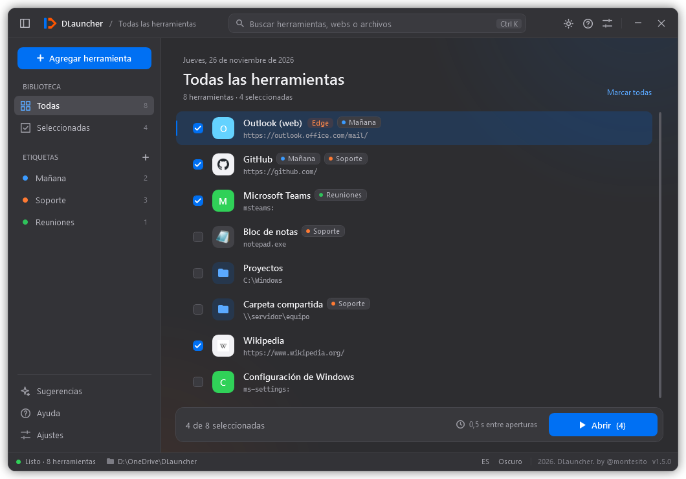
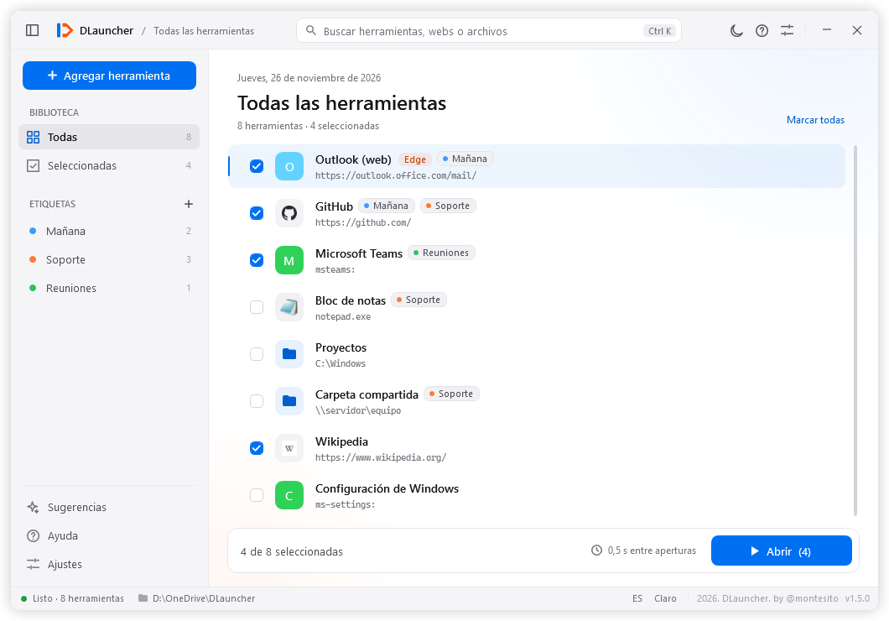
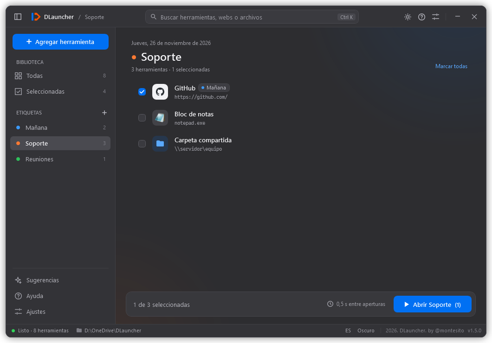
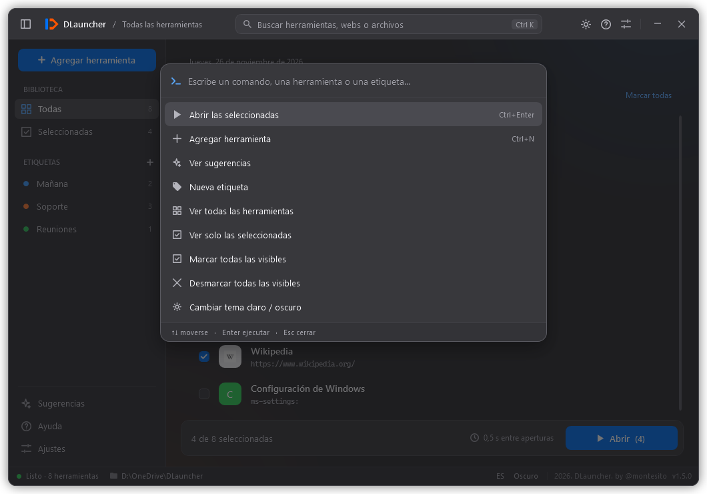
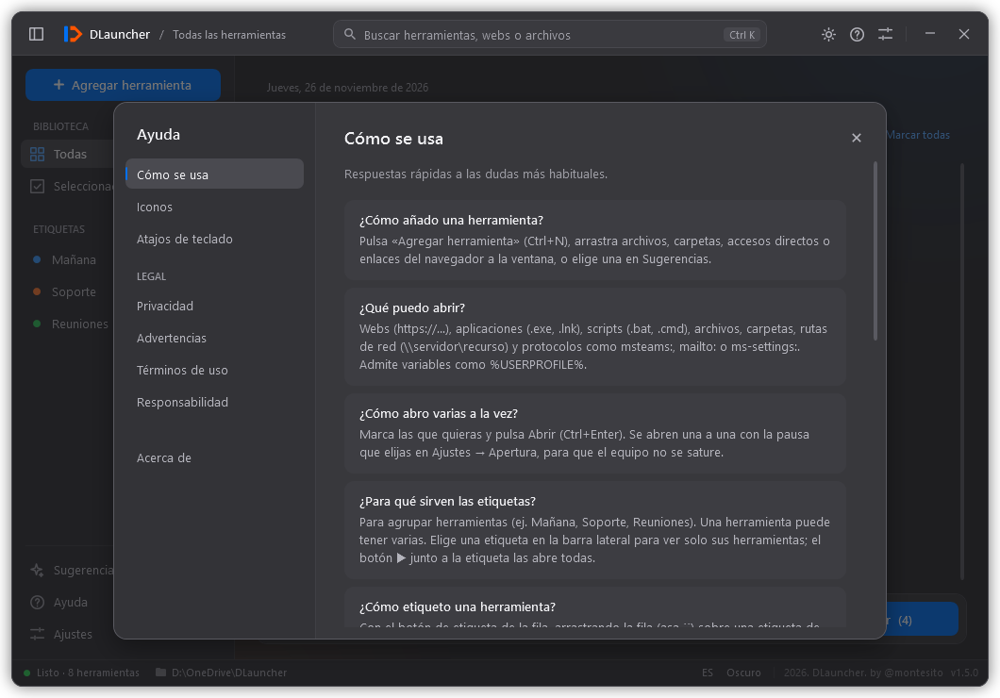

<p align="center">
  
</p>

<h1 align="center">DLauncher</h1>

<p align="center">
  <strong>Abre todo lo que necesitas para tu jornada con un solo clic.</strong><br />
  Webs, aplicaciones, archivos y carpetas, organizados a tu manera. Sencillo, privado y gratuito.
</p>

<p align="center">
  <a href="https://github.com/montesito/dlauncher/releases/latest/download/DLauncher.exe"></a>
</p>

<p align="center">
  <a href="https://github.com/montesito/dlauncher/releases/latest"></a>
  
  <a href="LICENSE"></a>
  
</p>

<p align="center">
  <a href="README.md">English</a> · <b>Español</b>
</p>

<p align="center">
  
  
</p>

---

## ¿Qué es DLauncher?

Cada mañana muchos abrimos lo mismo, una cosa tras otra: el correo, Teams, el portal de la empresa, una carpeta compartida, un par de herramientas internas… DLauncher lo reúne todo en una lista ordenada para que **abras tu jornada entera con un solo clic**.

- ✅ **Un clic y todo abierto:** marca lo que necesitas y pulsa **Abrir**.
- 🏷️ **Organizado con etiquetas:** por ejemplo *Mañana*, *Soporte* o *Reuniones*, y abre un grupo cada vez.
- 💡 **Sugerencias listas para usar:** Outlook, Teams, Word, Excel, Gmail, Slack y más, que puedes añadir, cambiar o quitar cuando quieras.
- 🌗 **Tema oscuro y claro,** en **español e inglés**.
- 🔒 **Privado:** sin cuentas ni rastreo; no se envía nada a ningún sitio.
- 🪶 **Ligero:** un único archivo, sin instalación y sin permisos de administrador.

---

## Descarga y primer inicio

1. **[Descarga DLauncher.exe](https://github.com/montesito/dlauncher/releases/latest/download/DLauncher.exe)** (última versión).
   También puedes ver [todas las versiones](https://github.com/montesito/dlauncher/releases) o descargarlo directamente desde la carpeta [`bin`](bin/DLauncher.exe).
2. **Haz doble clic.** No hay nada que instalar. Puedes guardar el archivo donde quieras, por ejemplo en el escritorio.
3. En el primer inicio, elige **idioma y tema**, acepta los **términos de uso** y elige una **carpeta donde guardar tu lista**. Una carpeta de OneDrive es buena opción: así tu lista te acompaña en todos tus equipos.

> [!NOTE]
> **¿Aparece «Windows protegió tu PC»?** DLauncher es gratuito y no está firmado digitalmente (los certificados de firma son caros), así que Windows puede avisarte la primera vez. Pulsa **Más información → Ejecutar de todas formas**. Si lo prefieres, deja que tu antivirus analice antes el archivo; todo el código fuente está en este repositorio para que cualquiera pueda revisarlo.

**Requisitos:** Windows 10 u 11. Nada más; todo lo que necesita ya viene con Windows.

---

## Cómo se usa

| Paso | Qué hacer |
| :---: | --- |
| **1. Añade** | Pulsa **Agregar herramienta** y pega una dirección web, o elige una aplicación, archivo o carpeta. También puedes **arrastrar** archivos, carpetas, accesos directos o enlaces del navegador a la ventana, o elegir algo en **Sugerencias**. |
| **2. Organiza** | Añade **etiquetas** para agrupar tus herramientas. Arrastra las filas para cambiar el orden. |
| **3. Abre** | Marca las herramientas que quieras y pulsa **Abrir**. Se abren una tras otra, con una breve pausa entre ellas para que el equipo no se ralentice. |

DLauncher recuerda lo que marcaste, así que mañana será un solo clic.

### ¿Qué puede abrir?

- **Webs,** en tu navegador favorito (Edge, Chrome, Brave o Firefox) e incluso en un perfil concreto del navegador.
- **Aplicaciones,** como Outlook, Teams, Excel o cualquier programa de tu equipo.
- **Archivos y carpetas,** incluidas las carpetas compartidas de red.
- **Accesos de Windows,** como `ms-settings:` (Configuración de Windows), `msteams:` o `mailto:`.

---

## Un vistazo más de cerca

| Etiquetas | Sugerencias |
| :---: | :---: |
|  |  |
| **Agrupa tus herramientas** y abre un grupo entero con un clic. | **Añade aplicaciones habituales** con un clic y luego cámbialas o quítalas como cualquier otra. |

| Paleta de comandos | Ayuda integrada |
| :---: | :---: |
|  |  |
| Pulsa **Ctrl+K** para encontrar al instante cualquier herramienta o acción. | Respuestas rápidas, guía de iconos, atajos, privacidad y términos. |

<p align="center">
  <br />
  <sub><b>Ajustes:</b> idioma, tema, pausa entre aperturas, inicio con Windows, copias de seguridad y más. Los cambios se guardan al momento.</sub>
</p>

---

## Más detalles útiles

- **Busca** en tu lista desde la barra de título.
- **Deshacer** si borras algo por error (Ctrl+Z o el botón del aviso).
- **Copia de seguridad automática** de tu lista cada vez que se guarda. Si el archivo se dañara, DLauncher recupera la copia por sí solo.
- **Exporta e importa** tu lista para compartirla con tu equipo.
- **Iniciar con Windows** (opcional), para que el lanzador te espere cada mañana.
- **Recuerda** el tamaño y la posición de la ventana en cada equipo.

### Atajos de teclado

| Teclas | Acción |
| --- | --- |
| `Ctrl` + `Enter` | Abrir las herramientas marcadas |
| `Ctrl` + `K` | Paleta de comandos |
| `Ctrl` + `N` | Agregar una herramienta |
| `↑` `↓` · `Enter` · `Espacio` | Moverse · abrir · marcar |
| `F2` · `Supr` | Editar · eliminar |
| `Ctrl` + `Z` | Deshacer |
| `Ctrl` + `B` | Mostrar u ocultar la barra lateral |
| `F1` | Ayuda |

---

## Privacidad

DLauncher respeta tu privacidad desde su diseño:

- **Sin cuentas, sin analíticas, sin rastreo.** No se envía nada sobre ti ni sobre tu lista.
- **Tu lista se queda en la carpeta que elijas,** en un sencillo archivo `config.json`.
- **El único uso de internet** es descargar, una sola vez, el pequeño icono de cada web de tu lista. Puedes desactivarlo en **Ajustes → Apariencia**.
- **Para borrarlo todo,** elimina la carpeta de tu lista y `%LOCALAPPDATA%\DLauncher`.

El aviso de privacidad, las advertencias y los términos de uso completos están dentro de la aplicación, en **Ayuda**.

---

## Seguridad y responsabilidad

DLauncher **no es intrusivo**: no instala nada, no cambia ajustes de Windows y solo escribe sus propios archivos. Simplemente abre lo que le pides, igual que harías tú a mano.

Se ofrece **«tal cual», sin garantía de ningún tipo**. El desarrollador **no se responsabiliza** de pérdidas de datos ni de otros daños derivados de su uso. Guarda tus propias copias de lo importante y sigue las políticas de TI de tu organización.

---

## Para desarrolladores

<details>
<summary>Ejecutar desde el código fuente, compilar el ejecutable y estructura del proyecto</summary>

<br />

DLauncher está escrito en **PowerShell 5.1 + WPF** (incluidos en Windows), sin dependencias externas.

**Ejecutar desde el código fuente**

```powershell
powershell -ExecutionPolicy Bypass -File .\src\Main.ps1
```

**Compilar `bin\DLauncher.exe`**

```powershell
powershell -ExecutionPolicy Bypass -File .\build.ps1
```

`build.ps1` une todos los módulos en un único script y lo compila con [PS2EXE](https://github.com/MScholtes/PS2EXE) (incluido en `tools\`). El número de versión se define en `src\Main.ps1` (`$Global:DLauncherVersion`).

> Los archivos fuente deben guardarse en **UTF-8 con BOM** para que Windows PowerShell 5.1 lea bien los acentos.

**Estructura del proyecto**

```
dlauncher/
├── assets/screenshots/   Imágenes del README (en / es)
├── bin/DLauncher.exe     Ejecutable listo para usar
├── src/
│   ├── Main.ps1          Punto de entrada: estado y eventos
│   ├── Assets/           Logo e iconos
│   ├── Config/           Guardado, copias, etiquetas, importar/exportar
│   ├── Core/             Apertura, navegadores, iconos, sugerencias
│   ├── UI/               Diseño, estilos y temas oscuro/claro
│   └── Utils/            Textos (español/inglés), preferencias, utilidades
├── tools/                Generador de iconos y compilador PS2EXE
└── build.ps1             Script de compilación
```

**Añadir un idioma:** todos los textos están en [`src/Utils/Localization.ps1`](src/Utils/Localization.ps1). Copia un bloque de idioma, tradúcelo y añádelo a `$Global:DLauncherLanguages`.

</details>

---

## Colaborar

Las ideas, avisos de errores y mejoras son bienvenidos. Abre una [incidencia](https://github.com/montesito/dlauncher/issues) o una pull request.
Si DLauncher te ahorra tiempo, una ⭐ en el repositorio ayuda a que otros lo encuentren.

## Licencia

Publicado bajo la **[Licencia MIT](LICENSE)**. Puedes usar, copiar, modificar y compartir DLauncher libremente, también con fines comerciales, siempre que conserves el aviso de copyright y des crédito al autor original.

El ejecutable se compila con [PS2EXE](https://github.com/MScholtes/PS2EXE), de Ingo Karstein y Markus Scholtes (Ms-PL).

---

<p align="center"><sub>2026. DLauncher. by <a href="https://github.com/montesito">@montesito</a></sub></p>
