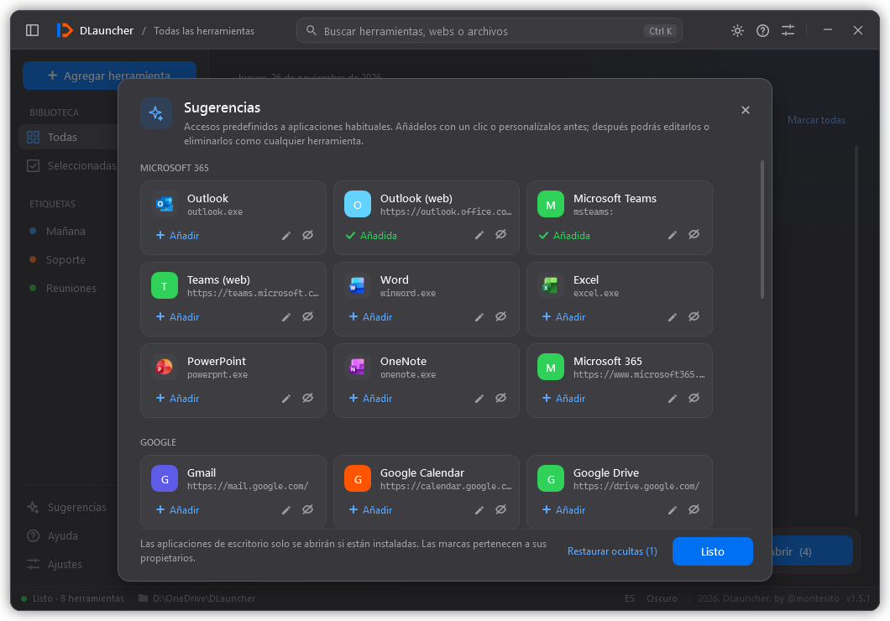
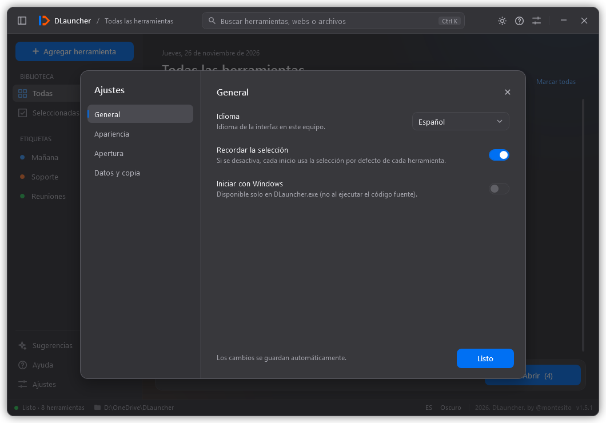

<p align="center">
  
</p>

<h1 align="center">DLauncher</h1>

<p align="center">
  <strong>Abre todo lo que necesitas para tu jornada con un solo clic.</strong><br />
  Un lanzador para <b>Windows 10 y 11</b>: webs, aplicaciones, archivos y carpetas, organizados a tu manera. Sencillo, privado y gratuito.
</p>

<p align="center">
  <a href="https://github.com/montesito/dlauncher/releases/latest/download/DLauncher.exe"></a>
</p>

<p align="center">
  <a href="https://github.com/montesito/dlauncher/releases/latest"></a>
  
  <a href="LICENSE"></a>
  
</p>

<p align="center">
  <a href="README.md">English</a> · <b>Español</b>
</p>

<p align="center">
  
  
</p>

---

## ¿Qué es DLauncher?

Cada mañana muchos abrimos lo mismo, una cosa tras otra: el correo, Teams, el portal de la empresa, una carpeta compartida, un par de herramientas internas… DLauncher lo reúne todo en una lista ordenada para que **abras tu jornada entera con un solo clic**.

- ✅ **Un clic y todo abierto:** marca lo que necesitas y pulsa **Abrir**.
- 🏷️ **Organizado con etiquetas:** por ejemplo *Mañana*, *Soporte* o *Reuniones*, y abre un grupo cada vez.
- 💡 **Sugerencias listas para usar:** Outlook, Teams, Word, Excel, Gmail, Slack y más, que puedes añadir, cambiar o quitar cuando quieras.
- 🌗 **Tema oscuro y claro,** en **español e inglés**.
- 🔒 **Privado:** sin cuentas ni rastreo; no se envía nada a ningún sitio.
- 🪶 **Ligero:** un único archivo, sin instalación y sin permisos de administrador.

---

## ¿Por qué DLauncher?

*«Para eso ya puedo hacer que mis aplicaciones se abran al iniciar Windows.»* Sí, pero tiene sus pegas:

- 🐢 **Windows arranca más lento,** y a veces **se queda pillado** intentando abrirlo todo a la vez justo al encender.
- 📅 **No todos los días necesitas lo mismo.** Un día toca soporte, otro reuniones, otro un proyecto concreto. El inicio automático abre siempre todo, lo necesites o no.
- 🧩 **Las webs y carpetas no se pueden** configurar fácilmente para que se abran al arrancar; DLauncher abre webs, aplicaciones, archivos y carpetas por igual.

DLauncher hace justo lo contrario: **tú decides qué abrir y cuándo**, con un clic, y las aperturas se escalonan con una breve pausa para que el equipo no se sature.

### Tu puesto de trabajo, siempre listo

Con el tiempo, DLauncher se convierte en **el mapa de tu trabajo diario**: el lugar donde están reunidas todas las herramientas, plataformas y aplicaciones que necesitas para hacer tu trabajo, en vez de estar repartidas entre marcadores, accesos directos del escritorio y la memoria.

- 🔁 **Apaga o reinicia sin pereza.** Como reabrir todo es un clic, puedes apagar el equipo al final del día o reiniciarlo cuando Windows lo pide (actualizaciones, lentitud…) sin pensar en el rato que tardarás en volver a abrirlo todo, una cosa tras otra. Un equipo que se reinicia a menudo funciona mejor y está más al día.
- 🧠 **No se te olvida nada.** Esa herramienta que solo usas los lunes, el portal que siempre recuerdas a media mañana, la carpeta compartida del equipo… todo está en la lista.
- ⏱️ **Empiezas a trabajar antes.** Pasas de diez o quince clics y búsquedas cada mañana a uno solo.
- 🗂️ **Orden y foco.** Las etiquetas separan contextos (*Mañana*, *Soporte*, *Reuniones*) para abrir solo lo que toca ahora.
- 🤝 **Fácil de compartir.** Exporta tu lista y pásasela a un compañero que se incorpora: tendrá todas las herramientas del equipo desde el primer día.
- 💻 **Te sigue entre entornos.** Si guardas la lista en una carpeta compartida, tendrás las mismas herramientas en el equipo de oficina, en el escritorio virtual o en el portátil.

---

## Seguro y sin virus: tecnología nativa de Windows

DLauncher está hecho **solo con componentes que ya trae Windows**: PowerShell, .NET Framework y WPF, la misma tecnología con la que están hechas muchas herramientas del propio sistema. Por eso funciona bien en cualquier Windows 10 u 11, sin instalar nada más.

- 🛡️ **Sin virus ni nada oculto.** Todo el código fuente está en este repositorio, abierto para que cualquiera lo revise.
- 🚫 **No instala nada:** sin drivers, sin servicios en segundo plano, sin cambios en el registro del sistema y sin permisos de administrador.
- 📁 **Solo escribe sus propios archivos:** tu lista y sus preferencias. Nunca toca tus documentos ni otros programas.
- 🔍 **Para tu tranquilidad,** te sugerimos analizarlo con tu antivirus antes de abrirlo. Es una buena práctica con cualquier descarga, y buena para todos.

> [!NOTE]
> **¿Por qué aparecen avisos al descargarlo?** Porque el `.exe` **no está firmado digitalmente**. La firma es un certificado de pago que usan las grandes empresas; sin ella, Windows y el navegador avisan de cualquier programa que no conocen, **no porque hayan encontrado nada peligroso**. Es lo habitual en el software gratuito y de código abierto.

---

## Descarga, paso a paso

**1. Descarga el archivo:** **[DLauncher.exe](https://github.com/montesito/dlauncher/releases/latest/download/DLauncher.exe)**.

**2. Primer aviso del navegador.** El navegador (Edge, Chrome…) puede indicar que el archivo *«no se descarga con frecuencia»* o que *«podría ser peligroso»*. Abre el menú del aviso (**⋯**) y elige **Conservar**.

**3. Segundo aviso, más llamativo** (con iconos rojos o de advertencia). Aparece porque el archivo no está firmado digitalmente. Pulsa **Mostrar más → Conservar de todas formas**.

**4. Listo:** DLauncher.exe ya está en tu carpeta de Descargas.

**5. Al abrirlo por primera vez,** Windows puede mostrar *«Windows protegió tu PC»*. Pulsa **Más información → Ejecutar de todas formas**. Solo ocurre la primera vez.

> [!TIP]
> **Pon el `.exe` donde quieras:** en el escritorio, en Documentos, en una carpeta de red o en un USB. No necesita instalarse, así que funciona en cualquier entorno: tu equipo de oficina, un escritorio virtual o un portátil.

**Requisitos:** Windows 10 u 11. Nada más; todo lo que necesita ya viene con Windows.

---

## Primer inicio: la carpeta de tu lista

Al abrir DLauncher por primera vez, eliges **idioma y tema**, aceptas los **términos de uso** y seleccionas la **carpeta donde se guardará tu lista** (el archivo `config.json`).

### Recomendado: una carpeta compartida entre tus equipos

Si trabajas en **más de un entorno**, por ejemplo tu **equipo de oficina** y un **escritorio virtual (EV)**, guarda la lista en una **unidad propia compartida** que veas desde los dos (tu unidad personal de red, OneDrive…).

Así, abras DLauncher donde lo abras, **cargará las mismas herramientas**, y cualquier cambio (añadir, quitar, editar o etiquetar) **aparecerá siempre en los dos entornos**.

Solo hay que configurarlo una vez en cada uno:

| Dónde | Qué hacer |
| --- | --- |
| **Primer equipo** (donde lo configuras por primera vez) | Crea una carpeta en tu unidad compartida, por ejemplo `DLauncher`, y selecciónala. Ya está. |
| **Segundo equipo o entorno** | Abre DLauncher y selecciona **esa misma carpeta compartida**. Aparecerá tu lista al momento. |

> [!NOTE]
> ¿Lo tienes abierto en los dos entornos a la vez? No pasa nada: **la lista se actualiza sola** en unos segundos con los cambios hechos en el otro.

### Mover la carpeta a otro sitio

Tu lista es solo una carpeta con un archivo, así que moverla es muy sencillo:

1. **Corta** (o copia) la carpeta y **pégala** donde la necesites (otra unidad, otra carpeta de red…).
2. En DLauncher, ve a **Ajustes → Datos y copia → Carpeta de configuración → Cambiar…** y selecciona la nueva ubicación. Tu lista se carga al momento.
3. Si la copiaste, borra la antigua cuando lo hayas comprobado.

> [!TIP]
> Si DLauncher no encuentra la carpeta donde la espera (porque la has movido, o porque la unidad de red no está conectada), **te avisa y te deja elegir la nueva ubicación** al momento. No borra ni crea nada, y si la unidad vuelve a estar disponible, carga tu lista sola.

### Compartir tu lista con un compañero

¿Alguien se incorpora al equipo y necesita las mismas herramientas? Tienes dos formas:

- **Pásale una copia de tu carpeta** (o solo el archivo `config.json`). Tu compañero la guarda donde quiera y la selecciona en DLauncher. Tendrá tu lista completa, con etiquetas incluidas, y podrá adaptarla a su gusto sin afectar a la tuya.
- **Exporta tu lista** desde **Ajustes → Datos y copia → Exportar** y envíale el archivo. Tu compañero lo añade con **Importar**: las herramientas se suman a las que ya tenga y llegan sin marcar, para que elija cuáles abrir.

> [!IMPORTANT]
> Revisa antes tu lista por si contiene enlaces o rutas que solo deban usar ciertas personas. DLauncher no guarda contraseñas, solo los nombres y direcciones de tus herramientas.

---

## Cómo se usa

| Paso | Qué hacer |
| :---: | --- |
| **1. Añade** | Pulsa **Agregar herramienta** y pega una dirección web, o elige una aplicación, archivo o carpeta. También puedes **arrastrar** archivos, carpetas, accesos directos o enlaces del navegador a la ventana, o elegir algo en **Sugerencias**. |
| **2. Organiza** | Añade **etiquetas** para agrupar tus herramientas. Arrastra las filas para cambiar el orden. |
| **3. Abre** | Marca las herramientas que quieras y pulsa **Abrir**. Se abren una tras otra, con una breve pausa entre ellas para que el equipo no se ralentice. |

DLauncher recuerda lo que marcaste, así que mañana será un solo clic.

### ¿Qué puede abrir?

- **Webs,** en tu navegador favorito (Edge, Chrome, Brave o Firefox) e incluso en un perfil concreto del navegador.
- **Aplicaciones,** como Outlook, Teams, Excel o cualquier programa de tu equipo.
- **Archivos y carpetas,** incluidas las carpetas compartidas de red.
- **Accesos de Windows,** como `ms-settings:` (Configuración de Windows), `msteams:` o `mailto:`.

---

## Un vistazo más de cerca

| Etiquetas | Sugerencias |
| :---: | :---: |
|  |  |
| **Agrupa tus herramientas** y abre un grupo entero con un clic. | **Añade aplicaciones habituales** con un clic y luego cámbialas o quítalas como cualquier otra. |

| Paleta de comandos | Ayuda integrada |
| :---: | :---: |
|  |  |
| Pulsa **Ctrl+K** para encontrar al instante cualquier herramienta o acción. | Respuestas rápidas, guía de iconos, atajos, privacidad y términos. |

<p align="center">
  <br />
  <sub><b>Ajustes:</b> idioma, tema, pausa entre aperturas, inicio con Windows, copias de seguridad y más. Los cambios se guardan al momento.</sub>
</p>

---

## Más detalles útiles

- **Busca** en tu lista desde la barra de título.
- **Deshacer** si borras algo por error (Ctrl+Z o el botón del aviso).
- **Copia de seguridad automática** de tu lista cada vez que se guarda. Si el archivo se dañara, DLauncher recupera la copia por sí solo.
- **Exporta e importa** tu lista para compartirla con tu equipo.
- **Sincronización automática:** si usas la misma carpeta en varios equipos, la lista se actualiza sola con los cambios de los demás.
- **Iniciar con Windows** (opcional): solo se abre la pequeña ventana de DLauncher, lista y esperando; nada más arranca hasta que tú lo decidas.
- **Recuerda** el tamaño y la posición de la ventana en cada equipo.

### Atajos de teclado

| Teclas | Acción |
| --- | --- |
| `Ctrl` + `Enter` | Abrir las herramientas marcadas |
| `Ctrl` + `K` | Paleta de comandos |
| `Ctrl` + `N` | Agregar una herramienta |
| `↑` `↓` · `Enter` · `Espacio` | Moverse · abrir · marcar |
| `F2` · `Supr` | Editar · eliminar |
| `Ctrl` + `Z` | Deshacer |
| `Ctrl` + `B` | Mostrar u ocultar la barra lateral |
| `F1` | Ayuda |

---

## Privacidad

DLauncher respeta tu privacidad desde su diseño:

- **Sin cuentas, sin analíticas, sin rastreo.** No se envía nada sobre ti ni sobre tu lista.
- **Tu lista se queda en la carpeta que elijas,** en un sencillo archivo `config.json`.
- **El único uso de internet** es descargar, una sola vez, el pequeño icono de cada web de tu lista. Puedes desactivarlo en **Ajustes → Apariencia**.
- **Para borrarlo todo,** elimina la carpeta de tu lista y `%LOCALAPPDATA%\DLauncher`.

El aviso de privacidad, las advertencias y los términos de uso completos están dentro de la aplicación, en **Ayuda**.

---

## Seguridad y responsabilidad

DLauncher **no es intrusivo**: no instala nada, no cambia ajustes de Windows y solo escribe sus propios archivos. Simplemente abre lo que le pides, igual que harías tú a mano.

Se ofrece **«tal cual», sin garantía de ningún tipo**. El desarrollador **no se responsabiliza** de pérdidas de datos ni de otros daños derivados de su uso. Guarda tus propias copias de lo importante y sigue las políticas de TI de tu organización.

---

## Para desarrolladores

<details>
<summary>Ejecutar desde el código fuente, compilar el ejecutable y estructura del proyecto</summary>

<br />

DLauncher está escrito en **PowerShell 5.1 + WPF** (incluidos en Windows), sin dependencias externas.

**Ejecutar desde el código fuente**

```powershell
powershell -ExecutionPolicy Bypass -File .\src\Main.ps1
```

**Compilar `bin\DLauncher.exe`**

```powershell
powershell -ExecutionPolicy Bypass -File .\build.ps1
```

`build.ps1` une todos los módulos en un único script y lo compila con [PS2EXE](https://github.com/MScholtes/PS2EXE) (incluido en `tools\`). El número de versión se define en `src\Main.ps1` (`$Global:DLauncherVersion`).

> Los archivos fuente deben guardarse en **UTF-8 con BOM** para que Windows PowerShell 5.1 lea bien los acentos.

**Estructura del proyecto**

```
dlauncher/
├── assets/screenshots/   Imágenes del README (en / es)
├── bin/DLauncher.exe     Ejecutable listo para usar
├── src/
│   ├── Main.ps1          Punto de entrada: estado y eventos
│   ├── Assets/           Logo e iconos
│   ├── Config/           Guardado, copias, etiquetas, importar/exportar
│   ├── Core/             Apertura, navegadores, iconos, sugerencias
│   ├── UI/               Diseño, estilos y temas oscuro/claro
│   └── Utils/            Textos (español/inglés), preferencias, utilidades
├── tools/                Generador de iconos y compilador PS2EXE
└── build.ps1             Script de compilación
```

**Añadir un idioma:** todos los textos están en [`src/Utils/Localization.ps1`](src/Utils/Localization.ps1). Copia un bloque de idioma, tradúcelo y añádelo a `$Global:DLauncherLanguages`.

</details>

---

## Colaborar

Las ideas, avisos de errores y mejoras son bienvenidos. Abre una [incidencia](https://github.com/montesito/dlauncher/issues) o una pull request.
Si DLauncher te ahorra tiempo, una ⭐ en el repositorio ayuda a que otros lo encuentren.

## Licencia

Publicado bajo la **[Licencia MIT](LICENSE)**. Puedes usar, copiar, modificar y compartir DLauncher libremente, también con fines comerciales, siempre que conserves el aviso de copyright y des crédito al autor original.

El ejecutable se compila con [PS2EXE](https://github.com/MScholtes/PS2EXE), de Ingo Karstein y Markus Scholtes (Ms-PL).

---

<p align="center"><sub>2026. DLauncher. by <a href="https://github.com/montesito">@montesito</a></sub></p>
