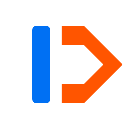
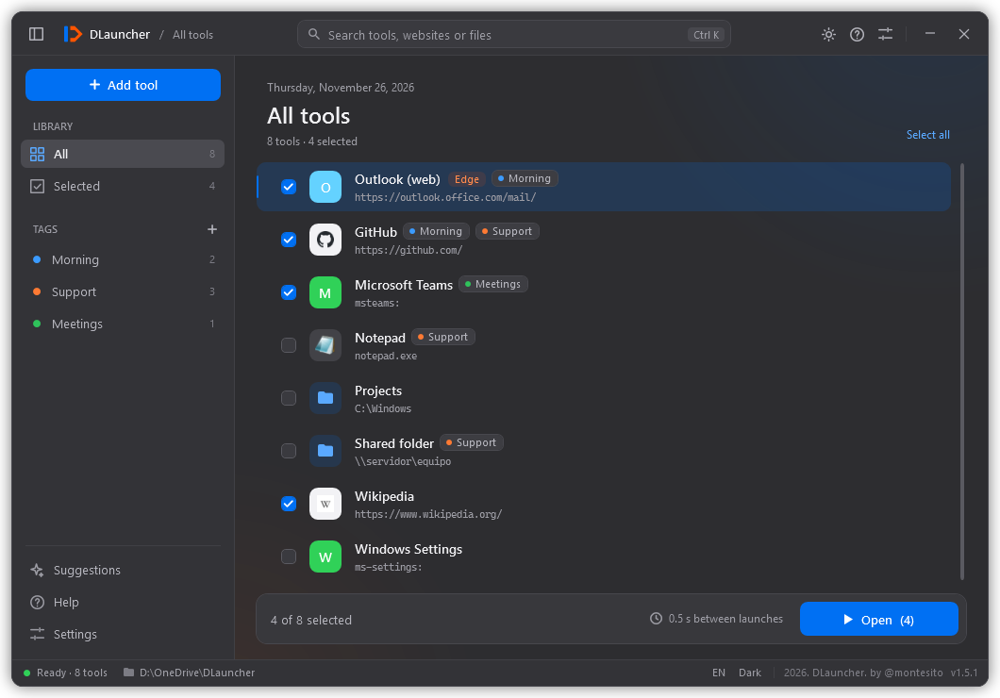
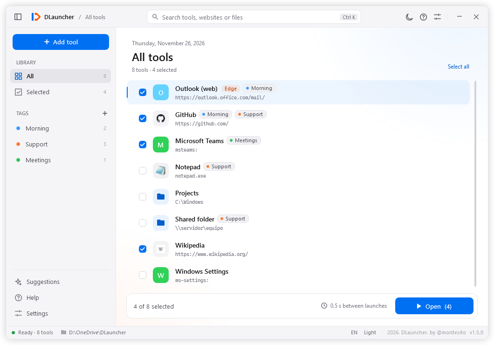
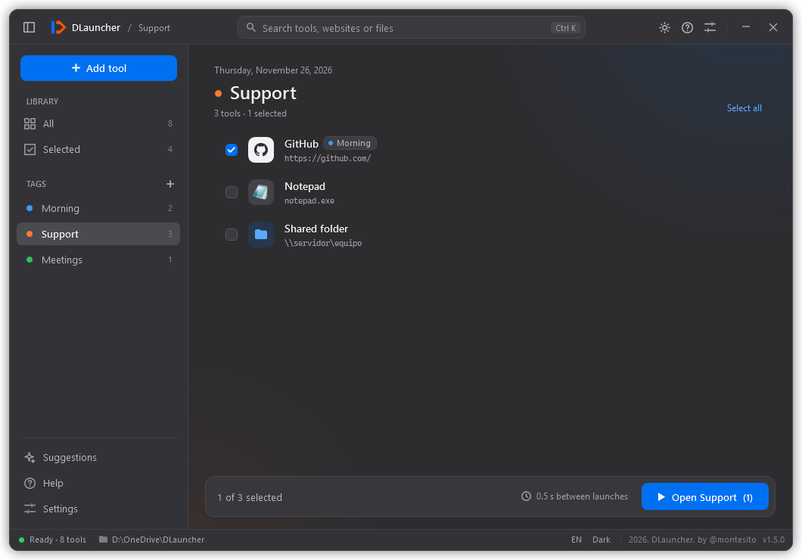
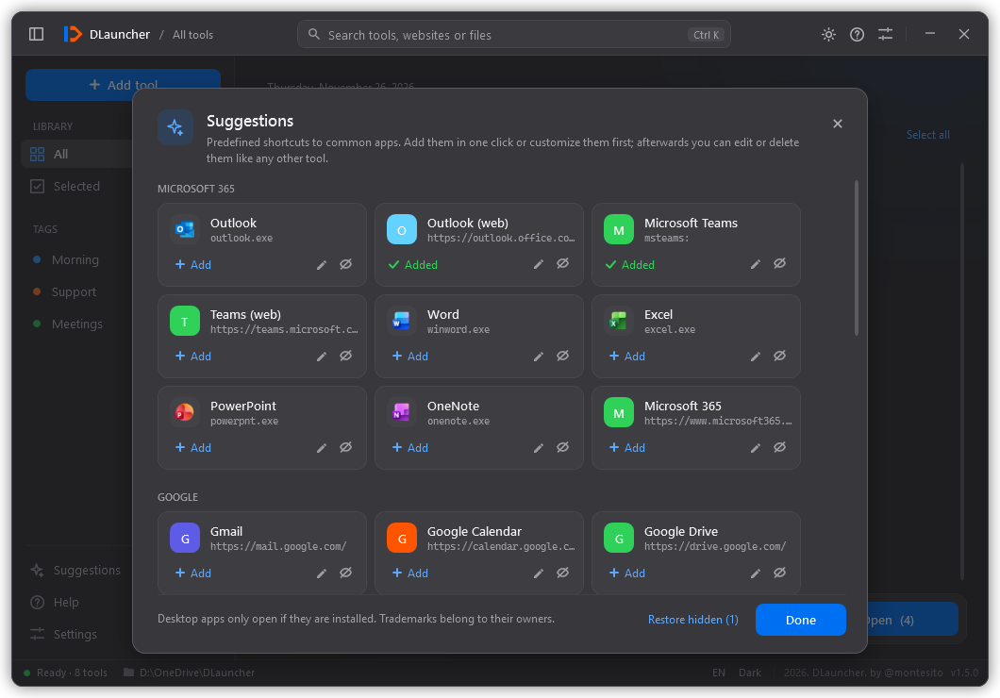
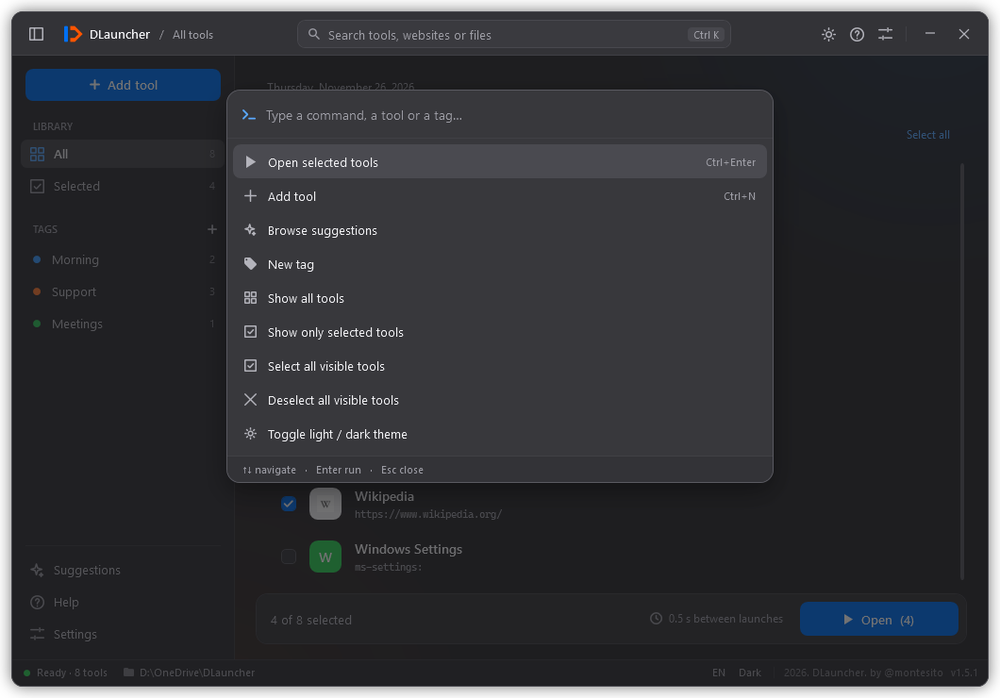
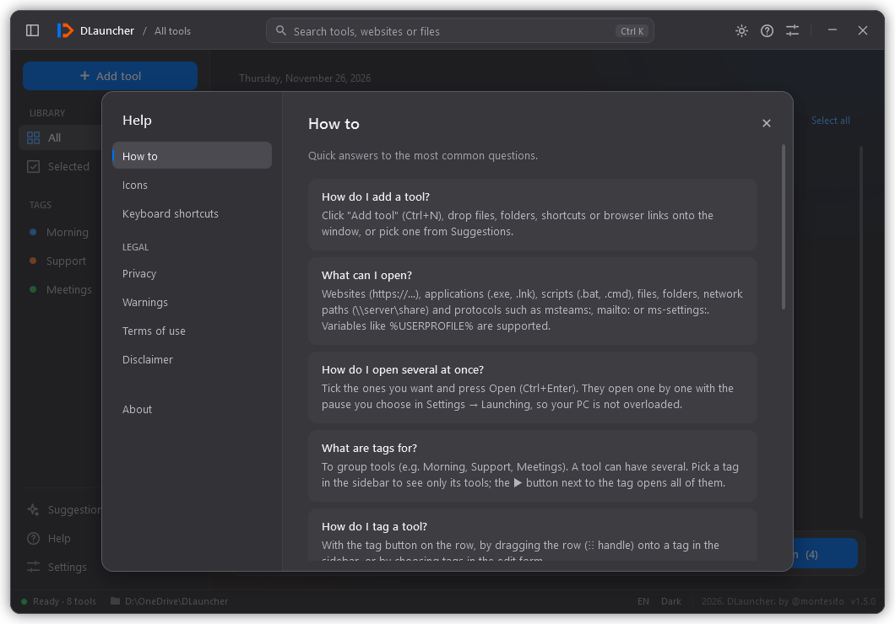
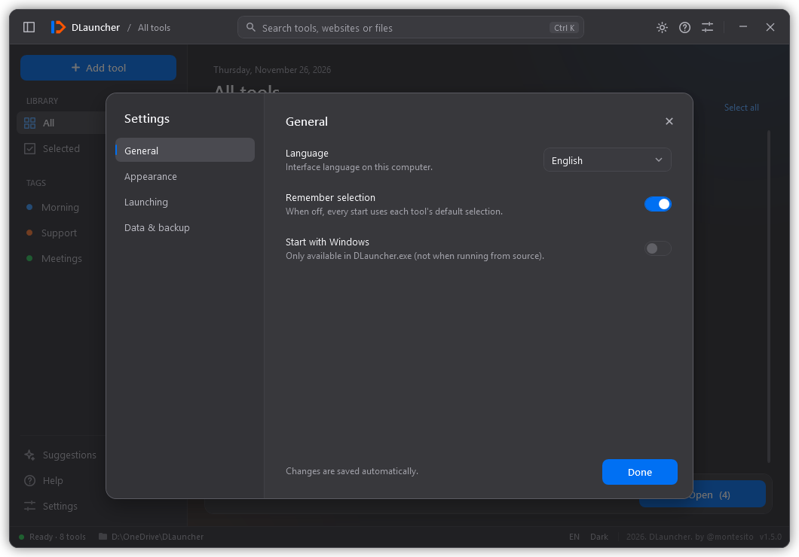

<p align="center">
  
</p>

<h1 align="center">DLauncher</h1>

<p align="center">
  <strong>Open everything you need for your workday with one click.</strong><br />
  A launcher for <b>Windows 10 and 11</b>: websites, apps, files and folders, organized your way. Simple, private and free.
</p>

<p align="center">
  <a href="https://github.com/montesito/dlauncher/releases/latest/download/DLauncher.exe"></a>
</p>

<p align="center">
  <a href="https://github.com/montesito/dlauncher/releases/latest"></a>
  
  <a href="LICENSE"></a>
  
</p>

<p align="center">
  <b>English</b> · <a href="README.es.md">Español</a>
</p>

<p align="center">
  
  
</p>

---

## What is DLauncher?

Every morning, many of us open the same things one by one: email, Teams, the company portal, a shared folder, a couple of internal tools… DLauncher keeps all of them in one tidy list, so you can **open your whole workday in a single click**.

- ✅ **One click, everything open:** tick what you need and press **Open**.
- 🏷️ **Organized with tags:** for example *Morning*, *Support* or *Meetings*, and open one group at a time.
- 💡 **Ready-made suggestions:** Outlook, Teams, Word, Excel, Gmail, Slack and more, which you can add, edit or remove whenever you like.
- 🌗 **Dark and light theme,** in **English and Spanish**.
- 🔒 **Private:** no accounts, no tracking, nothing is sent anywhere.
- 🪶 **Lightweight:** a single file, no installation and no admin rights.

---

## Why DLauncher?

*"I can just make my apps open when Windows starts."* You can, but it has downsides:

- 🐢 **Windows starts slower,** and sometimes **freezes** trying to open everything at once right after you switch it on.
- 📅 **You don't need the same things every day.** One day is support, another is meetings, another is a specific project. Startup apps always open everything, whether you need it or not.
- 🧩 **Websites and folders can't easily be set to open at startup.** DLauncher opens websites, apps, files and folders alike.

DLauncher does the opposite: **you decide what opens and when**, with one click, and launches are spaced out with a short pause so your PC doesn't get overloaded.

### Your workspace, always ready

Over time, DLauncher becomes **the map of your daily work**: one place that brings together all the tools, platforms and apps you need to do your job, instead of having them scattered across bookmarks, desktop shortcuts and memory.

- 🔁 **Shut down or restart without hesitation.** Since reopening everything takes one click, you can turn your PC off at the end of the day, or restart it when Windows asks (updates, slowness…), without dreading the time it takes to open everything again, one by one. A PC that restarts regularly runs better and stays up to date.
- 🧠 **Nothing gets forgotten.** That tool you only use on Mondays, the portal you always remember mid-morning, the team's shared folder… it's all on the list.
- ⏱️ **Start working sooner.** Go from ten or fifteen clicks and searches every morning to just one.
- 🗂️ **Order and focus.** Tags separate contexts (*Morning*, *Support*, *Meetings*) so you only open what you need right now.
- 🤝 **Easy to share.** Export your list and hand it to a new teammate: they'll have all the team's tools from day one.
- 💻 **Follows you across environments.** Save your list in a shared folder and you'll have the same tools on your office PC, your virtual desktop or your laptop.

---

## Safe and virus-free: native Windows technology

DLauncher is built **only with components that already ship with Windows**: PowerShell, .NET Framework and WPF, the same technology behind many of Windows' own tools. That's why it runs smoothly on any Windows 10 or 11 PC without installing anything else.

- 🛡️ **No viruses, nothing hidden.** The full source code is in this repository, open for anyone to review.
- 🚫 **Installs nothing:** no drivers, no background services, no system registry changes and no admin rights.
- 📁 **Only writes its own files:** your list and its preferences. It never touches your documents or other programs.
- 🔍 **For your peace of mind,** we suggest scanning it with your antivirus before opening it. It's good practice with any download, and good for everyone.

> [!NOTE]
> **Why do warnings appear when downloading?** Because the `.exe` **isn't digitally signed**. Signing requires a paid certificate that big companies use; without one, Windows and browsers warn about any program they don't recognize, **not because they found anything harmful**. This is normal for free, open-source software.

---

## Download, step by step

**1. Download the file:** **[DLauncher.exe](https://github.com/montesito/dlauncher/releases/latest/download/DLauncher.exe)**.

**2. First browser warning.** Your browser (Edge, Chrome…) may say the file *"isn't commonly downloaded"* or *"could be harmful"*. Open the warning's menu (**⋯**) and choose **Keep**.

**3. Second, more alarming warning** (with red or warning icons). It appears because the file isn't digitally signed. Click **Show more → Keep anyway**.

**4. Done:** DLauncher.exe is now in your Downloads folder.

**5. The first time you open it,** Windows may show *"Windows protected your PC"*. Click **More info → Run anyway**. This only happens once.

> [!TIP]
> **Put the `.exe` wherever you like:** on your desktop, in Documents, in a network folder or on a USB drive. It doesn't need installing, so it works in any environment: your office PC, a virtual desktop or a laptop.

**Requirements:** Windows 10 or 11. Nothing else; everything it needs is already part of Windows.

---

## First start: your list's folder

The first time you open DLauncher, you choose your **language and theme**, accept the **terms of use** and select the **folder where your list will be saved** (the `config.json` file).

### Recommended: a folder shared between your PCs

If you work in **more than one environment**, for example your **office PC** and a **virtual desktop**, save the list on a **personal shared drive** that both can reach (your personal network drive, OneDrive…).

That way, wherever you open DLauncher, **it loads the same tools**, and any change (adding, removing, editing or tagging) **always shows up in both environments**.

You only set it up once on each:

| Where | What to do |
| --- | --- |
| **First PC** (where you set it up first) | Create a folder on your shared drive, for example `DLauncher`, and select it. That's it. |
| **Second PC or environment** | Open DLauncher and select **that same shared folder**. Your list appears right away. |

You can change the folder any time under **Settings → Data & backup**.

---

## How to use it

| Step | What to do |
| :---: | --- |
| **1. Add** | Click **Add tool** and paste a web address, or choose an app, file or folder. You can also **drag** files, folders, shortcuts or browser links onto the window, or pick something from **Suggestions**. |
| **2. Organize** | Add **tags** to group your tools. Drag rows to change the order. |
| **3. Open** | Tick the tools you want and click **Open**. They open one after another, with a short pause between them so your PC doesn't slow down. |

DLauncher remembers what you ticked, so tomorrow it's just one click.

### What can it open?

- **Websites,** in your favorite browser (Edge, Chrome, Brave or Firefox) and even in a specific browser profile.
- **Apps,** such as Outlook, Teams, Excel or any program on your PC.
- **Files and folders,** including shared network folders.
- **Windows shortcuts,** such as `ms-settings:` (Windows Settings), `msteams:` or `mailto:`.

---

## A closer look

| Tags | Suggestions |
| :---: | :---: |
|  |  |
| **Group your tools** and open a whole group with one click. | **Add common apps** in one click, then change or remove them like any other tool. |

| Command palette | Built-in help |
| :---: | :---: |
|  |  |
| Press **Ctrl+K** to find any tool or action instantly. | Quick answers, an icon guide, shortcuts, privacy and terms. |

<p align="center">
  <br />
  <sub><b>Settings:</b> language, theme, pause between launches, start with Windows, backups and more. Changes are saved instantly.</sub>
</p>

---

## Handy extras

- **Search** your list from the title bar.
- **Undo** if you delete something by mistake (Ctrl+Z, or the button in the notice).
- **Automatic backup** of your list every time it's saved. If the file is ever damaged, DLauncher restores the backup by itself.
- **Export and import** your list to share it with your team.
- **Start with Windows** (optional): only DLauncher's small window opens, ready and waiting; nothing else starts until you choose.
- **Remembers** its window size and position on each PC.

### Keyboard shortcuts

| Keys | Action |
| --- | --- |
| `Ctrl` + `Enter` | Open the ticked tools |
| `Ctrl` + `K` | Command palette |
| `Ctrl` + `N` | Add a tool |
| `↑` `↓` · `Enter` · `Space` | Move · open · tick |
| `F2` · `Del` | Edit · delete |
| `Ctrl` + `Z` | Undo |
| `Ctrl` + `B` | Show or hide the sidebar |
| `F1` | Help |

---

## Privacy

DLauncher respects your privacy by design:

- **No accounts, no analytics, no tracking.** Nothing about you or your list is sent anywhere.
- **Your list stays in the folder you choose,** in a simple `config.json` file.
- **The only internet use** is downloading the small icon of each website in your list, once. You can turn this off in **Settings → Appearance**.
- **To remove everything,** delete your list's folder and `%LOCALAPPDATA%\DLauncher`.

The full privacy notice, warnings and terms of use are inside the app, under **Help**.

---

## Safety and disclaimer

DLauncher is **non-intrusive**: it installs nothing, changes no Windows settings and only writes its own files. It just opens what you ask it to, the same way you would by hand.

It is provided **"as is", without warranty of any kind**. The developer is **not responsible** for any loss of data or other damage arising from its use. Keep your own copies of anything important, and follow your organization's IT policies.

---

## For developers

<details>
<summary>Run from source, build the executable and project layout</summary>

<br />

DLauncher is written in **PowerShell 5.1 + WPF** (all included in Windows), with no external dependencies.

**Run from source**

```powershell
powershell -ExecutionPolicy Bypass -File .\src\Main.ps1
```

**Build `bin\DLauncher.exe`**

```powershell
powershell -ExecutionPolicy Bypass -File .\build.ps1
```

`build.ps1` merges every module into one script and compiles it with [PS2EXE](https://github.com/MScholtes/PS2EXE) (bundled in `tools\`). The version number is set in `src\Main.ps1` (`$Global:DLauncherVersion`).

> Source files must be saved as **UTF-8 with BOM** so Windows PowerShell 5.1 reads accented characters correctly.

**Project layout**

```
dlauncher/
├── assets/screenshots/   README images (en / es)
├── bin/DLauncher.exe     Ready-to-use executable
├── src/
│   ├── Main.ps1          Entry point: app state and events
│   ├── Assets/           Logo and icons
│   ├── Config/           Saving, backups, tags, import/export
│   ├── Core/             Launching, browsers, icons, suggestions
│   ├── UI/               Layout, styles and dark/light themes
│   └── Utils/            Texts (English/Spanish), preferences, file helpers
├── tools/                Icon generator and the PS2EXE compiler
└── build.ps1             Build script
```

**Adding a language:** all texts are in [`src/Utils/Localization.ps1`](src/Utils/Localization.ps1). Copy a language block, translate it and add it to `$Global:DLauncherLanguages`.

</details>

---

## Contributing

Ideas, bug reports and improvements are welcome. Please open an [issue](https://github.com/montesito/dlauncher/issues) or a pull request.
If DLauncher saves you time, a ⭐ on the repository helps others find it.

## License

Released under the **[MIT License](LICENSE)**. You're free to use, copy, modify and share DLauncher, including commercially, as long as you keep the copyright notice and give credit to the original author.

The executable is built with [PS2EXE](https://github.com/MScholtes/PS2EXE) by Ingo Karstein and Markus Scholtes (Ms-PL).

---

<p align="center"><sub>2026. DLauncher. by <a href="https://github.com/montesito">@montesito</a></sub></p>
